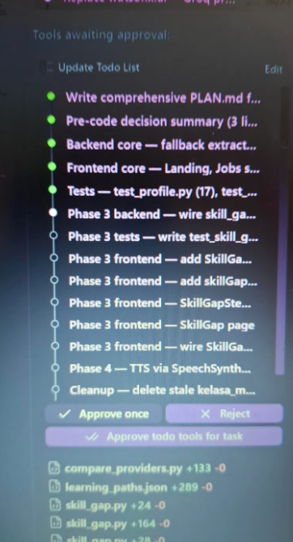
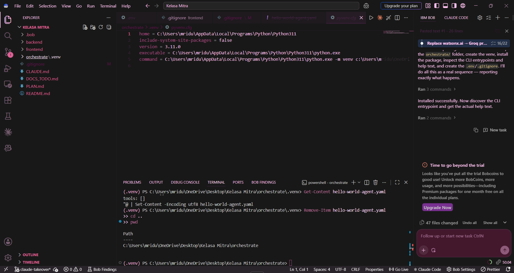

# The Bob story

How IBM Bob and Claude Code were used to build Kelasa Mitra, from the evidence in this repo:
[`docs/bob/`](docs/bob/) (Bob's outputs, copied unedited from the Bob panel), `.bob/` (Bob's
rules and audit report), and the git history. Bob's panel keeps no history, so anything not in
those files is not claimed here.

**Tools.** IBM Bob on a free trial of 50 Bobcoins, which ran out on the evening of 2026-11-07.
After that, **Claude Code** (Anthropic), a second AI coding tool. The owner directed both,
reviewed, tested and committed every change.

---

## Timeline

Times are IST. Bob's times are approximate (from the owner's notes in `docs/bob/README.md`),
except file and commit timestamps.

### 2026-11-07: IBM Bob

| Time | What Bob did | Evidence |
|---|---|---|
| ~19:39 | Wrote the first PLAN.md: FastAPI + a Google ADK `LlmAgent`, React 18 PWA, 6 phases, the 0.6/0.3/0.1 matching formula, screen sketches, risks, cut list. | `docs/bob/bob_plan_summary_2026-11-07.md` |
| ~20:14 | Built Phase 1 (profile extraction, skills and areas data, Landing screen) and reported 12/12 tests; still used Gemini/Google ADK. | `bob_phase1_summary_2026-11-07.md` |
| ~20:29 | At the owner's request replaced Gemini and Google ADK with watsonx.ai (Granite), made language detection follow the picker, and added Kannada/Hindi inflection handling; 17 tests. | `bob_phase1_fixes_2026-11-07.md` |
| ~20:46 | Built Phase 2 (80 sample jobs, ranking, reasons in en/kn/hi, swipeable cards, follow-up question); 40 tests. | `bob_phase2_summary_2026-11-07.md` |
| between ~20:46 and 21:17 | Swapped watsonx.ai for Groq as an optional provider with the rule-based fallback. No Bob output for this step was saved; inferred from the audit and the docs rewrite, which both describe Groq. | `bob_audit_2026-11-07.md`, `bob_docs_rewrite_summary_2026-11-07.md` |
| 21:17 (file time) | Wrote a project audit: found the stale database and the unwired skill-gap router, listed doc mismatches and a cleanup list. | `.bob/artifacts/kelasa-mitra-project-audit-report.html`, `docs/bob/bob_audit_2026-11-07.md` |
| 21:21 (file time) | `.bob/rules` last changed. | `.bob/rules` |
| ~21:34 | Rewrote PLAN.md and README.md (Groq, Orchestrate pending access, real folder tree) and listed six Orchestrate details it could not verify. | `bob_docs_rewrite_summary_2026-11-07.md` |
| ~21:42 | Installed the IBM watsonx Orchestrate ADK in `orchestrate/`; the trial's Bobcoins ran out mid-task. | `bob_orchestrate_install_and_trial_end_2026-11-07.md` |

### 2026-11-08 to 2026-11-14: Claude Code and the owner (from git log)

| Commit | Date | What changed |
|---|---|---|
| `a8117a6` | 2026-11-08 00:57 | "Bob baseline before Claude Code": the owner committed Bob's work as it stood. Bob's PLAN.md and README.md from this commit: `docs/bob/bob_PLAN_baseline.md`, `bob_README_baseline.md`. |
| `a46fd34`–`5366e94` | 2026-11-08 01:00–01:43 | Initial commit and merge, `.gitignore` cleanup, Orchestrate hello-world agent (first access check). |
| `171d3fd` | 2026-11-08 02:21 | Fix extraction and skill-gap bugs, replace real employer names with invented ones, wire the skill-gap router, build Phase 3 frontend, add tests. |
| `bb9dddf` | 2026-11-09 01:31 | Orchestrate tool package and agent, ADK-style token handling, warm-up script, agent panel. |
| `43a35b2` | 2026-11-09 03:03 | Evaluation, accessibility fixes, read-aloud, area chips, save-on-device, demo jobs, job-card design. |
| `a01f53e` | 2026-11-09 03:23 | Listening waveform and live words, agent thinking state, tappable learning steps. |
| `5ff5924` | 2026-11-09 15:13 | Language handling: speech language follows the picker mid-session, picker language on every endpoint, switch-language nudge. |
| `44170dc` | 2026-11-09 16:08 | 36 more demo jobs, favicon, hide repeated agent questions, security and reliability fixes. |
| `94b1e98` | 2026-11-09 16:59 | The owner added the author line and "Why I built this" to the README. |
| `3a48a93` | 2026-11-09 17:00 | The owner added the MIT LICENSE. |
| `f113bce` | 2026-11-09 17:09 | Docs stage: PLAN rewritten, BOB_STORY and the submission checklist added, `docs/bob/` evidence added. |
| `c194084` | 2026-11-09 21:31 | Language-first welcome flow (splash, three language cards, "Language: …" chip, "Listening in: …", no-speech hint); the ಕ app mark from Noto Sans Kannada (OFL, credited in NOTICE); fix for duplicated words from Android Chrome's partial results; search on the final transcript; "not recognised" message with 10 skill chips; Hindi/Kannada spelling normalisation, variants and one-letter tolerance; per-IP rate limits and a public demo note; Dockerfile and FastAPI serving the built frontend. |
| `39d343e` | 2026-11-09 22:17 | Final docs pass: README, PLAN, BOB_STORY, the submission checklist and the frontend README brought in line with the code. |
| `8e801ac`–`af911ff` | 2026-11-09 22:18–22:21 | The owner added the live demo link to the README. |
| `922377d`–`7cec75c` | 2026-11-09 22:23–22:34 | The owner added the Bob panel screenshots and notes to BOB_STORY.md (and fixed a doubled `.png` extension). |
| `fa478c5` | 2026-11-14 00:49 | Saved jobs shortlist kept in this browser only: swipe right, Save or the right-arrow key save the job (before, Save only raised a counter); a "Saved jobs (N)" button and list with a green trace, Remove and Back to Search; Delete my data also clears saved jobs. |
| (uncommitted) | 2026-11-14 | Final docs update for submission: live URL, saved jobs, early user test, limitations and re-measured test counts. |

On 2026-11-09 the owner verified the Orchestrate agent end to end: the console trace showed
`extract_profile`, `find_matches` and `skill_gap` called in order for "I cook, 2 years, I live in
Whitefield", `agent_warmup.py` got HTTP 200 replies, and the app's agent panel showed the tools'
text. On a real Android phone (plain http), typing Kannada under the English picker showed the
switch-language nudge and it switched correctly.

Later the same day, testing on that phone found two bugs that were then fixed: Android Chrome's
partial results filled the text box with repeated words, and a Hindi sentence with
"इलेक्ट्रिशियन" matched no skill because the speech engine wrote a short i vowel sign where the
synonym list had a long one. Over plain http with a Chrome flag, the owner saw the welcome screen,
finger tracing across the language cards, the language chip and the switch-language nudge work,
Hindi speech produce Devanagari text, and English speech work. The owner built and ran the Docker
image locally (rules only, and with keys via `--env-file`), deployed it on Render's free web
service from branch `main`, and that evening the live site showed the Orchestrate agent panel
with the tools' text. Speech over the live https link and Kannada speech on a phone are
UNVERIFIED.

Before submission, three people in the owner's building who had not seen the app tried it for a
few minutes (an informal test, not a study; date, device and browser not recorded): a watchman
and a domestic worker who spoke Hindi, and a garbage collector. All three used the microphone.
The two Hindi speakers were understood on the first try. The garbage collector first tried
Marathi, which the app does not support; she was told so, switched to Hindi, and was then
understood. Nothing else confused them, they found it easy, and they liked choosing the language
first. What the Marathi attempt produced in the text box was not recorded. Marathi is the next
language to add. Details and limits are in the README's impact section.

---

## Bob's mistakes and how they were caught

| What Bob did or said | How it was caught | What happened |
|---|---|---|
| The first plan and Phase 1 used **Google ADK and Gemini**, though the contest is about IBM products. | The owner, reading the plan and Phase 1 summary. | The owner asked Bob to replace them; Bob moved to watsonx.ai, then to Groq as an optional provider. Google ADK, Gemini and watsonx.ai are no longer used. |
| Phase 1 summary: pytest **exit code 1 was "only a deprecation warning"**. | Bob's next output. | Exit code 0 after `pytest.ini` was added. |
| **Stale SQLite database** (79 rows, old coordinates). | Bob's own audit. | The database is re-seeded from code; seed jobs now have fixed IDs, and the run instructions say to delete the old file. |
| **Skill-gap router written but never wired** into `main.py`. | Bob's own audit. | Wired by Claude Code in `171d3fd`, with tests and the Phase 3 screen. |
| "**`tsc --noEmit` exits with 0 errors**" (Phase 2 summary and audit). | Claude Code, 2026-11-08: the root `tsconfig.json` has `files: []`, so the command checks no files. | The real check is `npx tsc --noEmit -p tsconfig.app.json`; it first failed on missing speech-recognition types, fixed with `@types/dom-speech-recognition`. |
| Seed data used **real employer names** (e.g. "Chancery Pavilion"). | Claude Code's review. | Replaced with invented names; a test rejects known real company names. |
| Docs rewrite put **Orchestrate first on the cut list**. | The contest rules make Orchestrate required. | Taken off the cut list; the agent was built and verified. |
| Bob's README said **Bob wrote every line** and ran pytest and tsc after each change. | Git shows one baseline commit for all of Bob's work, and Claude Code changed most files afterwards. | The README now credits each tool for what it did. |

---

## Demo clip

- TODO: *Screenshots*

**1. Bob's task list during Phase 3 work (photo of the screen, 7 Nov 2026).** Green items are finished; the rest were still pending when the credits ran out.

**2. Bob panel in VS Code showing the files changed and the "Time to go beyond the trial" message.**

- TODO: owner to add the demo video link (app + Orchestrate trace).
